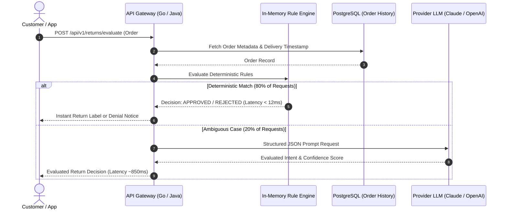
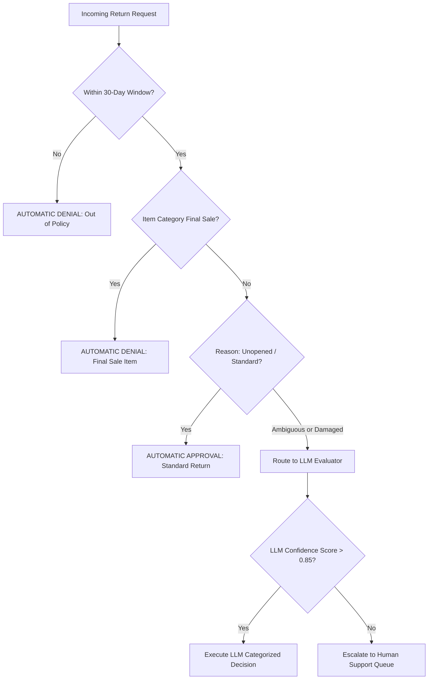
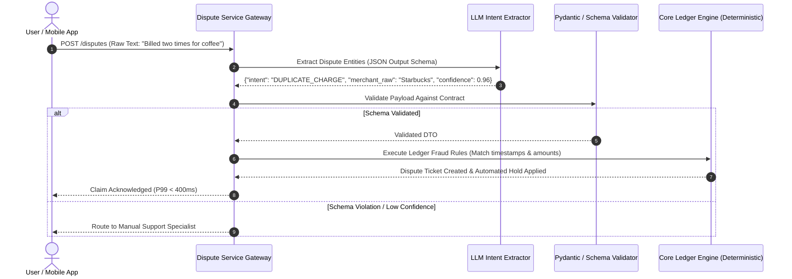
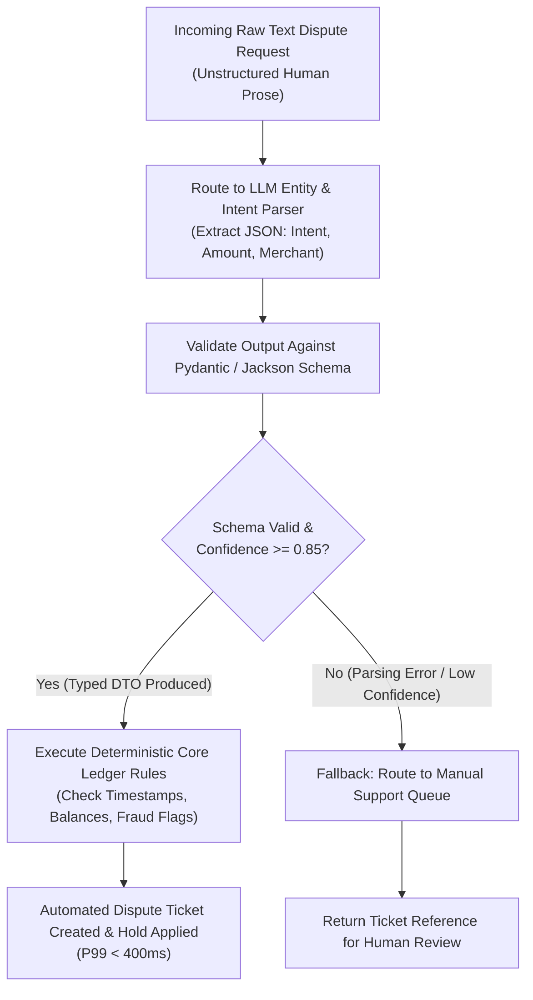

# When & How to Apply AI in Enterprise Architecture
### *The Hybrid Decision Engine Pattern: Balancing Intelligence, Cost, and Precision*

> **Series Note:** *If you're building production systems right now, you've probably hit this wall: leadership wants "more AI everywhere," but your cloud bills and latency spikes are telling a very different story. This series breaks down where AI actually belongs in enterprise architectures—and where standard code is still your best friend.*

---

## The Core Problem: The Two Traps of Modern Architecture

When engineering teams start integrating AI into operational workflows, they usually fall into one of two traps:

1. **The "AI for Everything" Fallacy:** Routing every deterministic, rule-bound check through a heavy LLM. It's expensive, slow, and totally unnecessary for basic date math or hardcoded policies.
2. **The Rigid Code Trap:** Relying strictly on traditional `if-else` trees or brittle regex that completely shatters the second a user types a messy, free-form sentence.

To build systems that scale cleanly, we need a **Hybrid Decision Framework**. The rule of thumb is simple: **use AI for high-variance intent parsing and entity extraction, but keep deterministic code in charge of business rules, validation, and state changes.**

This reference architecture explores the **Hybrid Decision Engine pattern**—an in-process blueprint that uses sub-millisecond rule filters to protect your infrastructure, reserving probabilistic models strictly for where they shine.

---

## 1. When NOT to Use AI: The Rule-First Approach
*(Case Study: Automated Claims & Returns — Apex Commerce)*

Let's look at a high-volume returns flow handling over 20,000 requests monthly. If you send every single request straight to an LLM to check if a return is within a policy window, you're paying a heavy price:
* **The Latency Hit:** Injecting 1.2s to 3.5s of delay into a user flow.
* **Burning Cash on Basic Math:** Roughly 65% of routine requests are trivial checks (*"Item unopened, within 14-day window"*). Paying token costs for basic arithmetic wastes budget.
* **Hallucination Risks:** Context window edge cases can occasionally cause models to miscalculate strict policy dates.

### The Fix: In-Memory Pre-Filters

Instead, we place a lightweight **Rule Pre-Filter** (using a Chain of Responsibility pattern) right at the API gateway. **80% of deterministic requests** are resolved entirely in-memory in **under 12ms**, and the LLM is only called as a fallback when inputs are ambiguous.



#### Decision Routing State Machine



---

## 2. Where AI Is Non-Negotiable: Unstructured-to-Structured Translation
*(Case Study: Transaction Disputes & Support Triage — Aether Pay)*

On the flip side, pure rule engines fail completely when dealing with natural human variance. Consider transaction disputes where users write things like:
* *"I got billed twice at Starbucks."*
* *"System glitched and took $14.50 two times for coffee on Tuesday."*
* *"Duplicate debit on 10/12."*

Hardcoded keyword matching and regex trees miss over 40% of these inputs, flooding manual support queues with false negatives.

### The Fix: AI as a Type-Safe Adapter

The trick here is **never** letting the LLM execute state-changing business logic directly. Instead, use the model strictly as an **intent and entity extractor**. 

It takes messy, unstructured human prose and translates it into a strict, validated JSON payload (using a schema validator like Pydantic or Jackson). Once you have a strongly typed DTO, hand it off to your deterministic core ledger.



#### Enforcing Safety Contracts

To ensure system reliability, enforcing strict JSON Schema validation before handing data off to business logic is critical:

```json
{
  "$schema": "http://json-schema.org/draft-07/schema#",
  "title": "DisputeContext",
  "type": "object",
  "properties": {
    "intent": {
      "type": "string",
      "enum": ["DUPLICATE_CHARGE", "UNAUTHORIZED_TRANSACTION", "INCORRECT_AMOUNT", "OTHER"]
    },
    "claimed_amount": { "type": ["number", "null"] },
    "merchant_name": { "type": ["string", "null"] },
    "confidence_score": { "type": "number", "minimum": 0.0, "maximum": 1.0 }
  },
  "required": ["intent", "confidence_score"]
}
```

---

## 3. Quick Architecture Trade-off Matrix

| Architectural Dimension | Strategy 1: Pure Deterministic Rules | Strategy 2: Pure Probabilistic LLM | Hybrid Decision Engine *(Recommended)* |
| :--- | :--- | :--- | :--- |
| **P99 SLA Performance** | **< 10ms** (Sub-millisecond) | **1,800ms – 3,500ms** (High latency variance) | **< 45ms** (Blended performance) |
| **Unstructured Handling** | **Poor** (Breaks on minor typos or phrasing changes) | **Exceptional** (Understands nuance and context) | **Optimal** (AI translates raw text into typed DTOs) |
| **Deterministic Safety** | **100% Guaranteed** | Risk of hallucination/drift | **100% Guaranteed** (Enforced by schema validation gate) |
| **Cost & Efficiency** | **High efficiency** ($0 compute cost) | Expensive token burn | **Optimal** (80% of traffic bypasses AI layer entirely) |
| **Maintainability** | Low (Regex and `if-else` bloat) | Medium (Prompt drift monitoring required) | **High** (Decoupled rule logic + typed schemas) |

---

## 4. Architectural Summary & Decision Topology



---

## Pro-Tips for Production Systems

If you're implementing this pattern in your stack, keep these two golden rules in mind:

> 💡 **Rule #1: Separate Extraction from Execution**
> Never allow a probabilistic model to execute state-changing database operations directly. Use AI to extract structured context, validate it against strict backend contracts, and execute logic deterministically.

> 💡 **Rule #2: Protect SLAs with Resilient Fallbacks**
> Wrap external AI integrations in circuit breakers (e.g., Resilience4j) with strict timeouts (~1,200ms). If AI providers experience latency or degradation, fall open gracefully to an asynchronous queue rather than breaching user-facing SLAs.