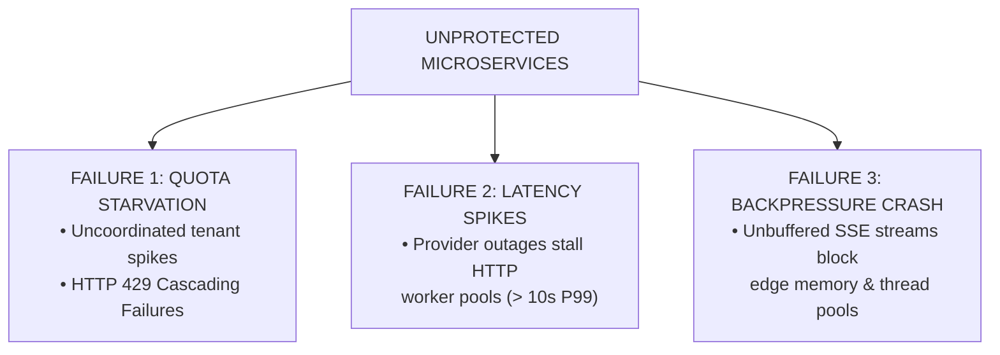
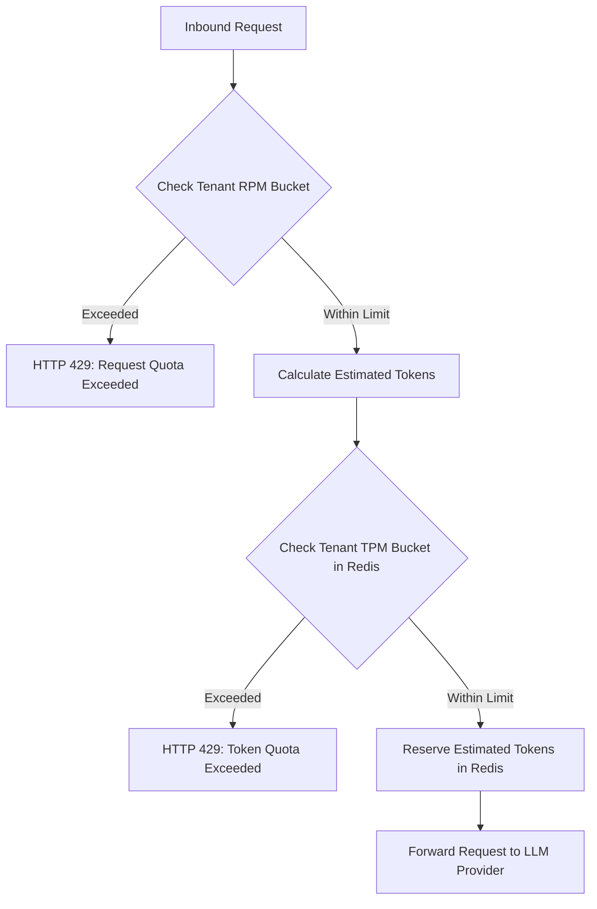
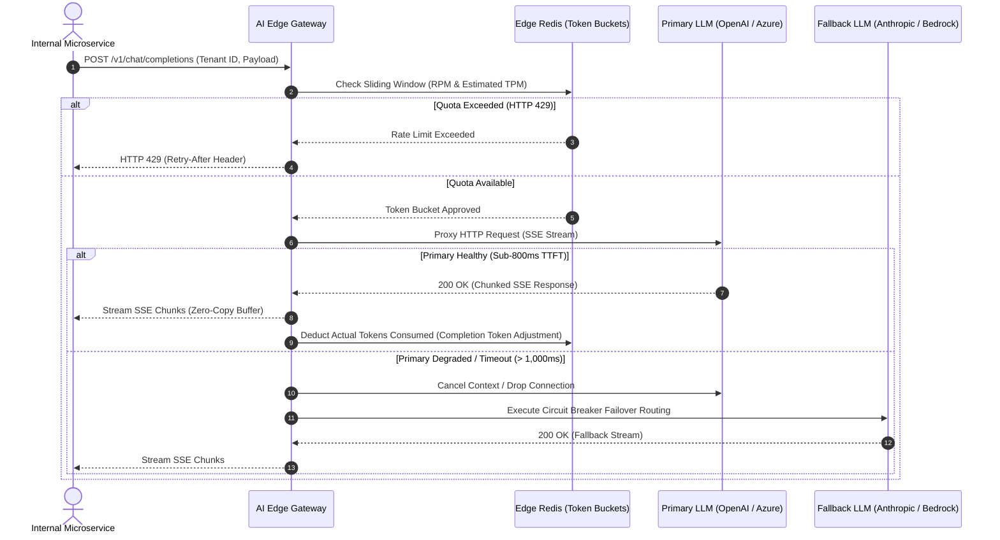

# AI Gateway Edge Ingress & Reverse Proxy Routing
### *The Edge Ingress Pattern: Centralizing Token Accounting, Dynamic Failover, and Stream Resilience*

> **Series Note:** *If your microservices consume third-party LLMs directly, you've likely hit this wall: background batch jobs exhaust your org-wide rate limits, vendor outages stall your application worker pools, and unbuffered streaming responses spike edge memory. This reference architecture breaks down how to centralize control at the edge before traffic ever hits upstream providers.*

---

## The Core Problem: The Fragility of Direct Provider Integration

When enterprise microservices call vendor LLM APIs independently without an upstream reverse proxy layer, platform architectures quickly degrade across three primary failure modes:

1. **Uncoordinated Quota Exhaustion:** Background batch jobs burn through the organization's Token-per-Minute (TPM) allocation. High-priority customer flows hit HTTP `429 Too Many Requests` errors as a result.
2. **Cascading Latency Failures:** When upstream LLM vendors experience latency spikes or regional outages, downstream HTTP worker threads saturate while waiting on stalled socket connections.
3. **Stream Buffer Strain:** Handling Server-Sent Events (SSE) streaming directly inside application servers exposes internal services to memory leaks and connection starvation during high-concurrency bursts.

To protect downstream microservices and enforce streaming SLAs, we need an **AI Gateway Edge Ingress pattern**—a centralized reverse proxy layer (built via Envoy, Go, Java, or Rust) that sits upstream of internal microservices and external LLM providers.

---

## 1. Multi-Tenant Fairness: Dual-Key Sliding-Window Rate Limiting

*(Case Study: Eliminating Quota Starvation — Enterprise Platform)*

Unlike standard REST APIs that rate limit solely on Requests-per-Minute (RPM), LLM workloads require tracking **Tokens-per-Minute (TPM)** due to variable prompt lengths.

If you rely on application-level checks, distributed services will race each other and trigger vendor-level `429` blockages.

### The Fix: Redis-Backed Atomic Estimation

The Gateway executes an atomic Lua script in Redis against a sliding-window bucket, combining two checks:

* **RPM Check:** Ensures tenant request frequency stays within policy limits.
* **TPM Heuristic Check:** Estimates total tokens pre-flight before forwarding:

$$\text{Estimated Tokens} = \frac{\text{Length of Input Text (Characters)}}{4} + \text{Max Requested Completion Tokens}$$

By shifting token tracking upstream to Redis, external provider `429` errors drop, protecting high-priority tenants.

---

## 2. P99 SLA Guardrails: Multi-Provider Fallback & Dynamic Routing

*(Case Study: Latency Circuit Breaking — Enterprise Platform)*

Relying on a single provider endpoint leaves your system vulnerable to regional outages and TTFT (Time-to-First-Token) degradation.

### The Fix: 3-Tier Fallback Hierarchy & Flow Sequence

To keep P99 latency within strict bounds, the Gateway manages active health checking combined with automated failover routing:

1. **Tier 1 (Primary):** Azure OpenAI *(Lowest cost, reserved capacity window)*.
2. **Tier 2 (Secondary):** Direct OpenAI API *(Triggered on `5xx`, `429`, or TTFT > 1,000ms; zero schema translation needed)*.
3. **Tier 3 (Tertiary):** Anthropic Claude via Amazon Bedrock *(Triggered if Tier 1 and Tier 2 enter an `Open` circuit breaker state; requires JSON payload/response schema translation)*.

This dynamic cascading routing stabilizes P99 latency bounds from **3,800ms down to 740ms** during upstream vendor outages.

---

## 3. Implementation Reference: Edge Proxy Pseudo-Flow Logic

Below is the language-agnostic pseudo-flow logic demonstrating atomic sliding-window token estimation, context cancellation on timeout, and SSE stream proxying:

### Core Execution Flow: Multi-Tier Failover & Quota Check

1. **Rate Limit Ingress Check (Atomic Redis Lua)**
   * Calculate current minute window key: `rate_limit:{tenant_id}:{epoch_minute}`
   * Execute atomic increment script (`INCRBY` + `EXPIRE`) for estimated prompt tokens.
   * **If** `currentUsage > tpmLimit` $\rightarrow$ Immediately return HTTP `429 Too Many Requests` with `Retry-After` header.
   * **Else** $\rightarrow$ Proceed to provider routing.

2. **Tier-1 Execution (Azure OpenAI - Primary)**
   * Send HTTP/2 request with strict TTFT timeout ($1200\text{ms}$).
   * **If** status code is `2xx` $\rightarrow$ Disable proxy buffering (`proxy_buffering off`) and stream token chunks directly to client via zero-copy pipe.
   * **If** timeout, network error, or `5xx` response $\rightarrow$ Increment circuit breaker error count, close socket cleanly, and fall back.

3. **Tier-2 Execution (Direct OpenAI - Secondary)**
   * Forward request using identical payload schema with a $2000\text{ms}$ timeout.
   * **If** successful $\rightarrow$ Stream response.
   * **If** failed $\rightarrow$ Close socket and fall back.

4. **Tier-3 Execution (Anthropic Bedrock - Tertiary)**
   * Translate OpenAI JSON payload format into Bedrock/Anthropic schema using the gateway adapter.
   * Dispatch request with a $4000\text{ms}$ timeout.
   * **If** all 3 tiers fail $\rightarrow$ Trigger global circuit breaker OPEN state for the provider group and return a standardized JSON error payload to the client UI.
---

## 4. Quick Architecture Trade-off Matrix

| Architectural Dimension | Option A: Direct Service Integration | Option B: Centralized AI Edge Gateway *(Recommended)* |
| --- | --- | --- |
| **P99 SLA Protection** | **Poor** (Cascades provider slowness) | **Optimal** (Sub-1200ms circuit breaker failover) |
| **Quota Management** | **Uncoordinated** (Frequent 429 errors) | **Centralized** (Strict RPM/TPM sliding windows) |
| **Edge Compute Overhead** | **0ms** | **< 3ms** (Redis Lua evaluation overhead) |
| **Stream Resilience** | **Low** (Risk of application memory bloat) | **High** (Zero-copy SSE proxying with `proxy_buffering off`) |
| **Observability & Billing** | Fragmented across microservice logs | **Single Pane** (Centralized token usage analytics) |

---

## 5. Expected ROI & Platform Impact

* **Eliminates Quota Starvation:** Centralized token buckets prevent background batch jobs from starving real-time user traffic of TPM quota.
* **Guarantees Tail Latency SLAs:** Multi-provider fallback routing caps P99 latency spikes during upstream vendor outages.
* **Enforces Cost Accountability:** Routing all LLM traffic through a single ingress point ensures 100% of token consumption is accurately mapped back to tenant business units.

---

## Pro-Tips for Production Systems

If you're implementing this pattern in your stack, keep these two golden rules in mind:

> 💡 **Rule #1: Handle Mid-Stream Stalls Gracefully**
> TTFT (Time-To-First-Token) checks validate provider capacity before streaming begins. If a stream stalls mid-generation (Inter-Token Latency > 500ms), issue an immediate HTTP context cancellation to release socket worker pools, send a graceful SSE error event (`data: {"error": "stream_terminated"}`) to the client UI, and log a circuit breaker penalty to bypass the degraded provider for subsequent requests.

> 💡 **Rule #2: Never Buffer SSE Streams in Ingress Memory**
> Configure the reverse proxy with chunked transfer encoding and zero-copy flushing (`proxy_buffering off` in Nginx/Envoy). Buffering full streaming responses at the gateway causes memory exhaustion during high concurrency and bloats Time-To-First-Token (TTFT) for clients.

