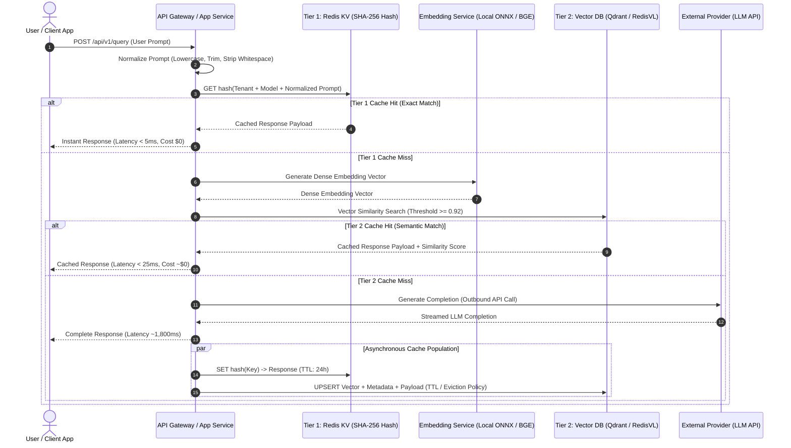
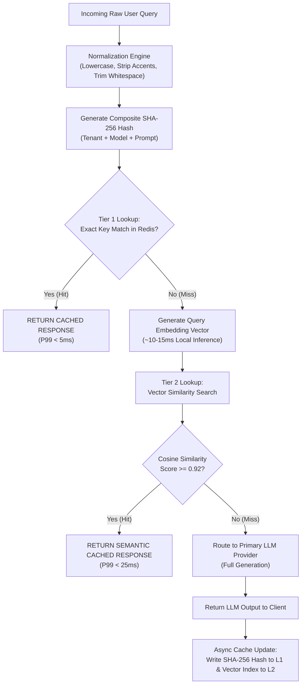

# Two-Tier Caching for LLM Systems

### *Combining Exact KV Hash Lookups and Semantic Vector Search to Slash Latency and API Expenditure*

> **Series Note:** *In high-throughput enterprise AI applications, making an outbound LLM call for every user request is an operational anti-pattern. Between provider rate limits (TPM/RPM), multi-second latency, and escalating token bills, production architectures require a caching layer. This case study breaks down how to design a resilient Two-Tier Caching pipeline using Redis for deterministic hits and vector databases for semantic equivalence.*

---

## The Core Problem: The Latency & Token Bill Bottleneck

When scaling LLM-backed services to thousands of active users, two core operational hurdles quickly emerge:

1. **The Cost & Latency Penalty of Repeated Queries:** Up to 40% of user queries in customer support, documentation search, or e-commerce assistants are identical or semantically equivalent (*"How do I reset my password?"* vs. *"I forgot my password, how to change it?"*). Routing each query through an outbound frontier LLM call typically costs **~$0.002–$0.03 per request** (depending on context window size and model tier) and adds **1.2s to 4.0s** of P99 latency.
2. **The Pitfall of Single-Tier Caching:**
   * **Exact Match Only (Key-Value):** Misses subtle variations in user phrasing, punctuation, or whitespace. A cache hit rate of `< 10%` is typical.
   * **Semantic Search Only (Vector DB):** Running dense vector embeddings and cosine similarity on every single incoming query introduces unnecessary compute overhead and potential false-positive cache returns for exact string matches.

To achieve **single-digit millisecond latency on exact matches** and **sub-25ms response times on semantic hits** while maintaining zero semantic drift, we implement a **Two-Tier Caching Pipeline**: **Tier 1 (L1 Exact Hash Cache)** catches identical requests instantly, while **Tier 2 (L2 Semantic Vector Cache)** evaluates semantic similarity for paraphrased queries.

---

## 1. Architectural Blueprint & Pipeline Flow

When a user query arrives at the service boundary, it passes through a multi-stage evaluation pipeline. If both cache tiers miss, the system forwards the request to the LLM, streams the result back to the client, and asynchronously updates both cache tiers.

---

## 2. Decision Logic & Tiered State Machine

To prevent cache poisoning and ensure high relevance, requests move through strict validation state gates before a cached answer is served or persisted:

---

## 3. Key Implementation Strategies

### Tier 1: Composite SHA-256 Hash Key Normalization

Exact caching fails if minor formatting differences (e.g., `"How to reset password?"` vs `"how to reset password?  "`) produce different keys. Furthermore, hashing the prompt alone risks cross-tenant leakage or serving stale responses after a model upgrade. Before hashing, apply a deterministic cleanup and scoping function:

1. Convert all characters to lowercase.
2. Strip trailing/leading punctuation and extra spaces.
3. Remove non-semantic noise (e.g., zero-width spaces).
4. Compute a scoped composite SHA-256 digest:
`key = "cache:exact:" + sha256(f"{tenant_id}:{model_id}:{system_prompt_hash}:{normalized_string}")`

### Tier 2: Semantic Similarity Thresholding & Metadata Scoping

Vector searching requires strict similarity bounds and tenant isolation to avoid returning irrelevant or unauthorized answers:

* **Similarity Threshold ($\ge 0.92$ Cosine Similarity):** Ensures the incoming prompt matches the cached intent almost identically. Anything below $0.90$ risks returning answers for different user intents (e.g., *"How do I delete my account?"* vs. *"How do I pause my account?"*).
* **Tenant & Model Scoping:** Vector indexes **must** enforce metadata pre-filters (`tenant_id == 'corp_a'` and `model_id == 'gpt-4o'`) before scoring similarity to prevent cross-tenant data leakage.
---

## 4. Quick Architecture Trade-off Matrix

| Architectural Dimension | Strategy 1: No Cache (Direct LLM) | Strategy 2: Single-Tier L1 (Exact Hash Only) | Strategy 3: Two-Tier Caching (L1 Hash + L2 Vector) |
| --- | --- | --- | --- |
| **P99 SLA Performance** | **1,500ms – 4,000ms** | **< 5ms** (on hit) / **> 1,500ms** (on miss) | **< 5ms** (L1 Hit) / **< 25ms** (L2 Hit) |
| **Cache Hit Rate** | **0%** | **5% – 12%** (Low flexibility) | **35% – 55%** (High flexibility) |
| **Infrastructure Complexity** | **Minimal** (Simple client/SDK) | **Low** (Redis Key-Value store) | **Medium-High** (Redis + Vector DB + Embedding Pipeline) |
| **Estimated Token Savings** | **0%** | **~10%** reduction | **40% – 60%** reduction in total API bill |
| **Risk of Semantic Drift** | **None** | **None** | **Low** (Controlled via $\ge 0.92$ Similarity Threshold) |

---

## Pro-Tips for Production Systems

> 💡 **Rule #1: Implement Variable TTLs Based on Content Volatility**
> Static documentation answers can be cached for days or weeks (e.g., $TTL = 7 \text{ days}$), whereas dynamic operational queries (e.g., order tracking or real-time balances) must either bypass Tier 2 semantic caching completely or use very short TTLs ($TTL = 60 \text{ seconds}$) to prevent serving stale data.

> 💡 **Rule #2: Asynchronously Hydrate Caching Layers**
> Never block the user-facing response thread while writing to L1/L2 caches. After the LLM returns its payload, stream the response directly to the user while dispatching cache updates asynchronously via worker pools or background event queues.

